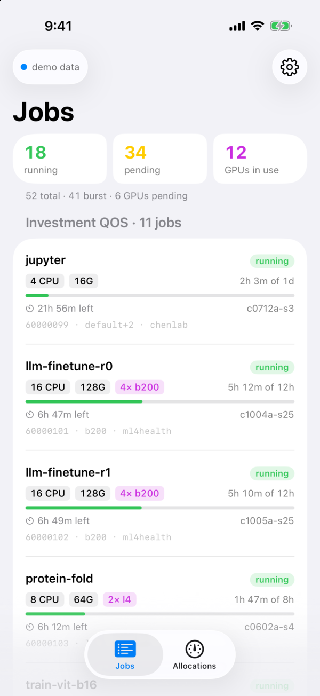
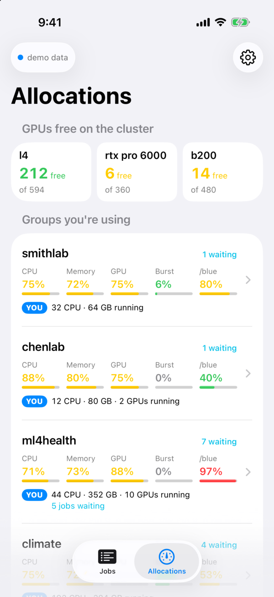
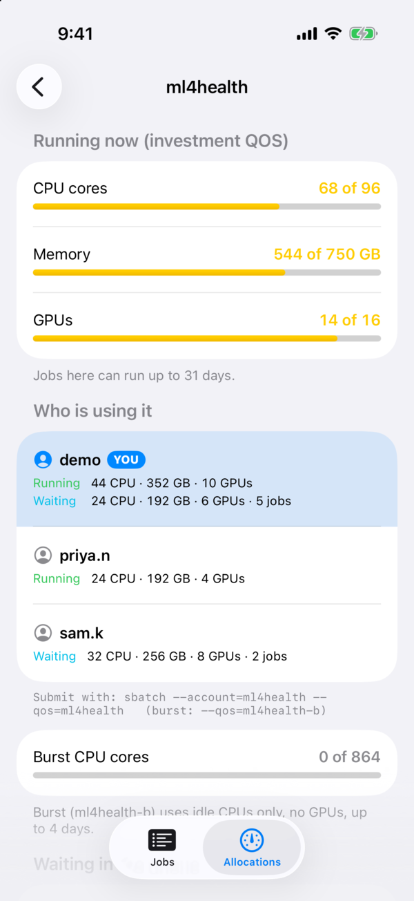
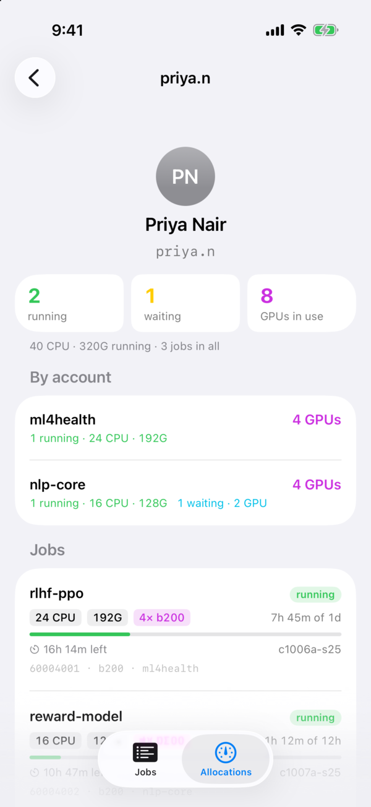
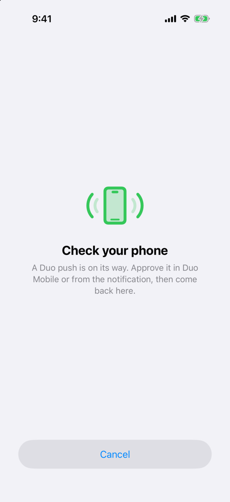
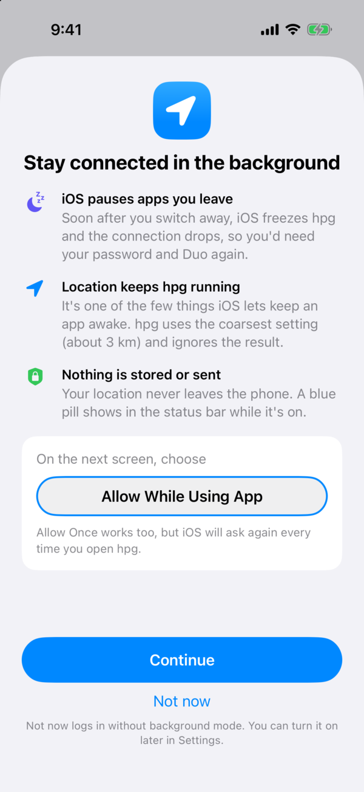

<p align="center"></p>

<h1 align="center">hpg</h1>

<p align="center">Your <a href="https://www.rc.ufl.edu/about/hipergator/">HiPerGator</a> Slurm jobs and allocations, live on your iPhone.</p>

<p align="center">
  
  
  
  
  
</p>

<p align="center"><sub>Screenshots use the built-in demo data; every group, user and job in them is made up.</sub></p>

## What it shows

- **Jobs**: running, pending and GPU counts; each job's resources, time used and time left, and the
  pending reason in plain words ("waiting on another job", "group GPU limit reached"). Burst (`-b` QOS)
  jobs get their own section, and 3 or more look-alike jobs (such as array tasks) merge into one "×N" row.
- **Allocations**: free GPUs on the cluster by type; your groups first, with CPU / memory / GPU / burst /
  `/blue` gauges against each group's limits and your own share; a page per group showing who is
  running and waiting in it.
- **People**: tap anyone in a group to see everything they're running or waiting on, in every account
  (`squeue -u`): their name, totals, a per-account breakdown (handy for spotting who holds the GPUs),
  and each job.
- Refreshes jobs every 15 s and allocations every 30 s (both adjustable), plus pull to refresh.

## How it works

- **Login**: SSH straight from the phone to `hpg.rc.ufl.edu` with your password and Duo (HiPerGator
  doesn't accept SSH keys). hpg answers the password prompt, picks **Duo Push** for you, and opens
  Duo Mobile so you can approve it. If the push is denied or unavailable, you get the full Duo menu,
  which also takes passcodes. There's no server in between; your password is only stored in the
  iPhone Keychain, and only if you choose *Remember password*.
- **Commands**: everything runs on the login node and is read-only: `squeue`, `sacctmgr`, `sinfo`,
  `blue_quota` and `getent` (for full names). hpg never submits or cancels jobs.
- **Staying connected**: see [Why hpg asks for your location](#why-hpg-asks-for-your-location).
- **Host key**: pinned on first login (trust on first use) and checked on every login after.

## Why hpg asks for your location



iOS freezes an app a few seconds after you switch away from it, and a frozen app's SSH connection
drops. Without a workaround you'd type your password and approve Duo again every time you came back.

iOS only lets apps keep running in the background for a few reasons (playing audio, navigation,
calls…), and location updates are the one an SSH app can use. Blink Shell does the same. So with
*Stay connected in background* on (the default):

- hpg asks for the **coarsest** location (about 3 km) and **ignores** the results. Nothing is stored
  or sent anywhere, including to HiPerGator.
- It's only active while you're logging in or connected; disconnecting turns it off.
- You'll see the blue location pill in the status bar while hpg is in the background.
- Swiping hpg away in the app switcher still ends the session.

The first time you tap **Connect**, hpg explains this before iOS asks. Choose **Allow While Using
App**. *Allow Once* also works, but iOS will ask again every time you open hpg. Prefer not to? Tap
*Not now* (or turn the setting off later in Settings): hpg works the same while it's on screen, you
still get about 30 seconds to approve Duo in another app, and leaving it for longer means logging in
again.

<br clear="right">

## Install

hpg isn't on the App Store; you build it onto your own phone. With a free Apple ID that works for
7 days at a time (press Run in Xcode again to renew); a paid developer account makes it last a year.

### With Xcode

1. Install Xcode and [XcodeGen](https://github.com/yonaskolb/XcodeGen) (`brew install xcodegen`).
2. Clone the repo, then generate and open the project:
   ```bash
   xcodegen generate
   open hpg.xcodeproj
   ```
3. Add your Apple ID in Xcode › Settings › Accounts (a free one is fine).
4. Set your team: either pick it under the hpg target › **Signing & Capabilities**, or create
   `Config/Local.xcconfig` (git-ignored) with `DEVELOPMENT_TEAM = <your team ID>` so it survives
   `xcodegen generate`. If Xcode says the bundle ID is taken, change `PRODUCT_BUNDLE_IDENTIFIER` in
   `project.yml` to something unique.
5. Plug in your iPhone, unlock it, and tap **Trust**. Turn on Settings › Privacy & Security ›
   **Developer Mode** (it appears after the phone has been connected to Xcode once; the phone restarts).
6. Choose your iPhone as the run destination and press **⌘R**. The first time, Xcode spends a few
   minutes preparing the phone; keep it unlocked meanwhile.
7. If the app won't open ("Untrusted Developer"), go to Settings › General › VPN & Device Management ›
   your Apple ID › **Trust**, then run again.

### With a sideloading tool

Each [release](../../releases) has an unsigned `hpg.ipa` that tools such as AltStore or Sideloadly can
sign with your own Apple ID and install, without Xcode.

### First login

Enter your GatorLink username and password and tap **Connect**. Allow location **While Using App**
(see [why](#why-hpg-asks-for-your-location)), approve the Duo push, and come back to hpg.

## Develop

- Debug launch arguments: `-demo` opens on demo data (`-tab 1` for Allocations); `-duo` shows a sample
  Duo menu; `-pushwait` shows the "Check your phone" screen; `-locationintro` shows the location explainer.
- `hpg/Model/Slurm.swift` has the remote commands and their parsers;
  `hpg/SSH/SSHClient.swift` wraps libssh2 (keyboard-interactive auth, exec, keepalive).
- The icon's source is `Design/icon.svg`.
- libssh2 1.11.0 and OpenSSL 1.1.1w come prebuilt in `Vendor/CSSH.xcframework` (from
  [DimaRU/Libssh2Prebuild](https://github.com/DimaRU/Libssh2Prebuild)). See
  [THIRD_PARTY_NOTICES.md](THIRD_PARTY_NOTICES.md).

## Notes

hpg is an unofficial personal project, not affiliated with or supported by UF Research Computing.
Be kind to the shared login nodes: the default refresh intervals are deliberately modest.

[MIT License](LICENSE)
